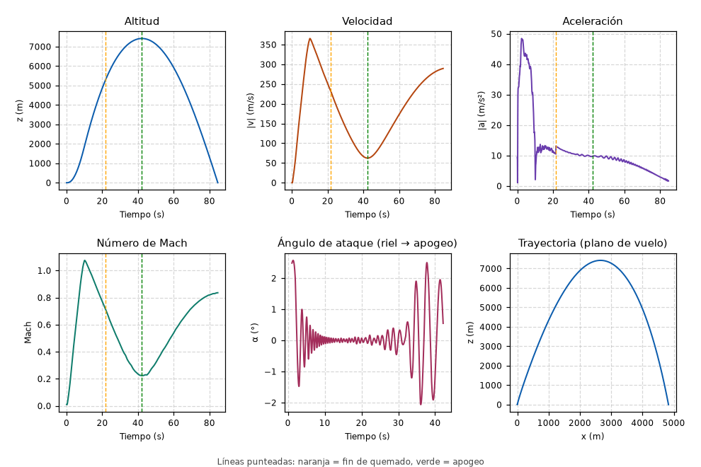
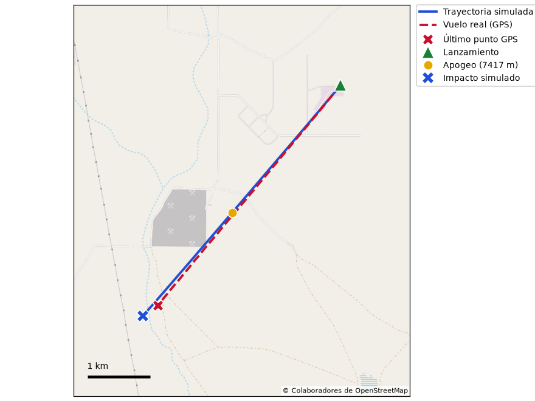

# Simulador de vuelo de cohetes (3-DOF) — Propulsión UNAM

Simulador de la trayectoria de un cohete suborbital. Resuelve el movimiento en el plano de vuelo: traslación más el ángulo de cabeceo. Lo escribí como parte de mi tesis de licenciatura en Matemáticas (Facultad de Ciencias, UNAM), *Simulación Numérica de la Dinámica de un Cohete Híbrido*, trabajando con el equipo Propulsión UNAM de la Facultad de Ingeniería. El cohete de referencia es el Xitle II, un cohete híbrido con óxido nitroso como oxidante que el equipo voló en 2024.

Mi tesis completa está en el repositorio: [Tesis_UNAM_NataliaMejBau_COMPLETAFINAL.pdf](./Tesis_UNAM_NataliaMejBau_COMPLETAFINAL.pdf).

## Qué hace

- Arma el cohete a partir de sus piezas (nariz, tubos, aletas, boattail, tanques, carga interna) y calcula masa, centro de gravedad, centro de presión y momento de inercia. La masa cambia durante el quemado según la tabla del motor.
- Integra el vuelo desde el riel hasta el impacto con empuje tomado de una curva medida, arrastre con Cd en función del Mach, fuerza normal, gravedad variable con la altura y viento con ráfagas.
- Usa la altitud del sitio y la temperatura, presión y viento del día del lanzamiento.
- Da las coordenadas donde cae el cohete y las muestra en un mapa real junto con el sitio de lanzamiento.
- Permite desplegar un paracaídas en el apogeo.
- Deja elegir el integrador: Euler, RK2, RK4 y Runge-Kutta-Fehlberg, que programé yo, o los de SciPy (RK23, RK45, DOP853, LSODA, BDF).
- Tiene una interfaz gráfica para cambiar el cohete y las condiciones de lanzamiento sin tocar el código, y scripts para graficar, animar y comparar contra los datos del vuelo real.

## Cómo se ve

<table>
  <tr>
    <td align="center"></td>
    <td align="center"></td>
  </tr>
  <tr>
    <td align="center">Esquema del Xitle II con su CG y CP.</td>
    <td align="center">Vuelo libre del Xitle II con DOP853.</td>
  </tr>
</table>

<p align="center">
  <br>
  Vuelo del Xitle II en Spaceport America: trayectoria simulada y trayectoria GPS real.
</p>

Las tres figuras las dibuja el programa (son las que aparecen dentro de la interfaz, guardadas a archivo); no son capturas de la ventana.

## Instalación

Hace falta Python 3 con `tkinter`. Está probado con Python 3.12. El Python de Homebrew no trae `tkinter`; en ese caso hay que instalar también el paquete `python-tk` o usar otra distribución.

```bash
git clone https://github.com/Meijix/RocketTrajectorySimulator-PropulsionUnam.git
cd RocketTrajectorySimulator-PropulsionUnam
python -m venv venv
source venv/bin/activate        # en Windows: .\venv\Scripts\activate
pip install -r requirements.txt
```

Dependencias: `numpy`, `scipy`, `pandas`, `matplotlib`, `customtkinter`, `tkintermapview`, `tqdm` y `seaborn`.

## Uso

Todo se ejecuta desde la carpeta raíz del repositorio.

### Interfaz gráfica

```bash
python -m Simulador.GUI.ModernGUI
```

La ventana abre con los datos del Xitle II ya cargados, así que se puede simular de inmediato.

1. **Cohete.** Dimensiones, masas y posiciones de cada componente. La posición Z se mide desde la punta de la nariz hasta el frente de la pieza. "Actualizar Cohete" redibuja el esquema con el CG y el CP.
2. **Tablas de Datos.** Curva de empuje, Cd contra Mach y masa del motor. Se pueden importar otros CSV, con las mismas columnas que los de `Archivos/`.
3. **Simulación.** Sitio de lanzamiento (coordenadas y altitud), atmósfera del día, viento, riel (longitud, elevación y azimut), paso de tiempo, integrador y si el vuelo lleva paracaídas.
4. **Análisis (CG-CP).** Tabla por componente y margen estático al despegue y con los tanques vacíos.
5. **Resultados.** Tras "Ejecutar Simulación" aparecen el resumen del vuelo, con las coordenadas donde cae el cohete, y las gráficas. "Exportar CSV" guarda la trayectoria, con latitud y longitud de cada punto.
6. **Mapa.** Mapa real de la zona (OpenStreetMap) con el sitio de lanzamiento, la trayectoria sobre el terreno, el apogeo y el punto de impacto con sus coordenadas. "Abrir mapa interactivo" lo abre en el navegador, donde se puede acercar y mover. Si el lanzamiento es desde el sitio del vuelo real, se dibuja también la trayectoria GPS medida.

"Guardar Datos" y "Cargar Datos" escriben y leen la configuración completa en un archivo JSON.

Por defecto el sitio, la atmósfera y el viento son los del vuelo real del Xitle II (Spaceport America, 22 de junio de 2024). Para otro lanzamiento basta cambiar las coordenadas, la altitud y el azimut, y elegir el viento constante.

Tres avisos:

- El mapa necesita conexión a internet. Sin ella, la trayectoria se dibuja sobre un fondo en blanco y las coordenadas se muestran igual.
- En la pestaña "Simulación" hay además un mapa pequeño del sitio que solo funciona con Tk 8. Con Tk 9 la librería de ese mapa cierra el programa, así que en su lugar se muestran las coordenadas. La pestaña "Mapa" funciona con cualquier versión.
- De los dos paracaídas del formulario solo se simula el drogue, que se abre en el apogeo. El principal cuenta como masa.

### Sin interfaz

```bash
python -m Simulador.src.VueloLibre        # sin paracaídas
python -m Simulador.src.VueloParacaidas   # con paracaídas
```

El cohete se define en `Simulador/src/XitleFile.py` y las condiciones (riel, viento, paso, integrador) en `Simulador/src/condiciones_init.py`. Los resultados se guardan en `Simulador/Resultados/OutputFiles/` como CSV y JSON.

Con esos archivos trabajan los scripts de `Simulador/Visualizacion/` (gráficas y animaciones) y `Simulador/Resultados/real_vs_simulada.py`, que compara la altura simulada con la medida.

### Pruebas

```bash
pip install -r requirements-dev.txt
python -m pytest tests
```

Tardan medio minuto. Comparan la atmósfera con la ISA, los integradores con soluciones analíticas y varios vuelos completos entre sí.

## El modelo

El estado del cohete es posición, velocidad, ángulo de cabeceo y velocidad angular. Las fuerzas son:

- **Empuje.** Interpolado de la curva del motor, a lo largo del eje del cohete.
- **Arrastre.** Con el Cd interpolado de una tabla contra el número de Mach. El paracaídas, cuando está abierto, suma su propio arrastre.
- **Fuerza normal.** Proporcional al seno del ángulo de ataque. Aplicada en el centro de presión, es la que endereza al cohete.
- **Gravedad.** Disminuye con la altura.
- **Viento.** Horizontal, con ráfagas. Puede ser constante o un perfil que cambia con la altura. Cada segundo se sortean una ráfaga, que se suma a la rapidez base, y una pequeña desviación de la dirección, y se interpola entre sorteos. Las ráfagas tienen además una componente vertical pequeña, de media cero. Con una semilla, el viento se repite igual en cada corrida.

Mientras el cohete está en el riel no gira.

### Sitio, atmósfera y viento del día

El origen del simulador es el sitio de lanzamiento. El eje x apunta hacia donde se inclina el riel (su azimut, medido desde el norte), y con eso cada punto de la trayectoria se convierte a latitud y longitud.

La atmósfera es la estándar (ISA) por capas, ajustada al sitio y al día con tres datos: la altitud del sitio, la diferencia de temperatura respecto a la ISA y la presión medida en el sitio. La presión a cada altura sale de integrar el equilibrio hidrostático desde el sitio, y la densidad de la ecuación de gas ideal. Sin esos datos queda la ISA al nivel del mar.

Para el vuelo real del Xitle II los valores están en `Archivos/DatosVuelo/condiciones_2024-06-22.json`, con sus fuentes:

| Dato | Valor | De dónde sale |
| --- | --- | --- |
| Sitio | 32.94753° N, 106.91019° O, 1395 m s. n. m. (Spaceport America) | primer punto GPS del rastreador |
| Fecha y hora | 22 de junio de 2024, hacia las 12:20 hora local | registro GPS y nombre del archivo |
| Azimut del lanzamiento | 220° | rumbo de la trayectoria GPS |
| Elevación del riel | 84° | la que reproduce la trayectoria GPS |
| Temperatura en superficie | 28 a 31 °C (ISA + 20 °C en toda la columna) | reanálisis ERA5 y archivo de pronósticos |
| Presión en el sitio | 868.5 hPa | ídem |
| Viento en superficie | 1 a 2 m/s del oeste-noroeste, ráfagas de 2 a 5 m/s | ídem |
| Viento en altura | 3 m/s a 6 km y 7 m/s a 7.7 km, del sur-suroeste | ídem |

Los datos meteorológicos son de modelo (Open-Meteo), no mediciones en la plataforma. Con ISA + 20 °C el modelo reproduce las alturas de 700, 600, 500 y 400 hPa de ese día con menos de 0.5 % de error en la presión. El viento se usa como perfil con la altura, con la dirección en convención meteorológica (de dónde viene, en grados desde el norte).

Los centros de presión y los coeficientes de fuerza normal de la nariz, las aletas y el boattail salen de las fórmulas de Barrowman. El desarrollo completo está en mi tesis.

### Integradores

| Nombre en el código | Método | Paso |
| --- | --- | --- |
| `Euler` | Euler explícito, orden 1 | fijo |
| `RungeKutta2` | Heun (trapecio explícito), orden 2 | fijo |
| `RungeKutta4` | Runge-Kutta clásico, orden 4 | fijo |
| `RKF45` | Runge-Kutta-Fehlberg 4(5) | adaptativo |
| `RK23` (SciPy) | Bogacki-Shampine 3(2) | adaptativo |
| `RK45` (SciPy) | Dormand-Prince 5(4) | adaptativo |
| `DOP853` (SciPy) | Dormand-Prince de orden 8, con estimadores de orden 5 y 3 | adaptativo |
| `LSODA` (SciPy) | Adams y BDF con cambio automático | adaptativo |
| `BDF` (SciPy) | Diferenciación hacia atrás, orden 1 a 5 | adaptativo |

Los cuatro primeros los programé para la tesis y están en `Paquetes/PaqueteEDOs/integradores.py`. Los demás son los de `scipy.integrate.solve_ivp`.

Ojo con los nombres: el `RK45` de SciPy no es Runge-Kutta-Fehlberg sino Dormand-Prince 5(4). Los dos son pares de orden 4 y 5, pero con coeficientes distintos. El Fehlberg es `RKF45`.

En los métodos de paso fijo el paso configurado es el que se usa siempre. En los adaptativos es el paso máximo. La integración se detiene al tocar el suelo.

La lista de métodos, con sus nombres, está en un solo lugar (`Paquetes/PaqueteEDOs/metodos.py`) y de ahí la toman el simulador, la interfaz y todas las comparaciones.

### Comparación de los integradores en el vuelo completo

```bash
python -m Simulador.Visualizacion.compare_integ
```

Simula el mismo vuelo con los nueve métodos y los compara con una solución de referencia (DOP853 con un paso cinco veces menor). Guarda la tabla y las figuras en `Simulador/Resultados/OutputFiles/ComparacionIntegradores/`. Para el vuelo libre del Xitle II con paso de 0.01 s:

| Método | Apogeo | Diferencia de apogeo con la referencia | Evaluaciones de f | Tiempo de cómputo |
| --- | --- | --- | --- | --- |
| Euler | 7416 m | −0.59 m | 8 466 | 3.0 s |
| RK2 | 7417 m | 0.39 m | 16 932 | 4.4 s |
| RK4 | 7417 m | 0.09 m | 33 864 | 7.3 s |
| RKF45 | 7417 m | 0.04 m | 51 108 | 10.5 s |
| RK23 | 7417 m | −0.05 m | 25 418 | 6.2 s |
| RK45 | 7417 m | −0.08 m | 50 798 | 10.5 s |
| DOP853 | 7417 m | −0.02 m | 101 600 | 18.7 s |
| BDF | 7417 m | −0.10 m | 17 241 | 5.3 s |
| LSODA | 7417 m | −0.10 m | 12 382 | 3.9 s |

Los tiempos dependen de la máquina; las evaluaciones de f no.

## Comparación con el vuelo real

El Xitle II voló el 22 de junio de 2024 en Spaceport America. Hay tres registros: la trayectoria GPS del rastreador Featherweight, la altura de la telemetría ASYB y la curva de altura contra tiempo. El cohete bajó sin paracaídas: el último punto GPS lo muestra a 399 m de altura cayendo a 273 m/s.

La simulación usa el sitio, la atmósfera y el viento de ese día (vuelo libre, DOP853):

| | Vuelo real | Simulación |
| --- | --- | --- |
| Apogeo sobre el sitio | 6573 m (GPS), 6569 m (curva de altura) | 7417 m |
| Tiempo al apogeo | unos 40 s | 42.2 s |
| Distancia horizontal en el apogeo | 2532 m | 2660 m |
| Rumbo de la trayectoria | 220° | 221° |
| Punto de caída | último GPS en 32.91602°, −106.94135°, a 4553 m del sitio | 32.91453°, −106.94387°, a 4831 m |
| Velocidad de caída | 273 m/s a 399 m de altura | 287 m/s en el impacto |

La trayectoria sobre el terreno coincide bien: el impacto simulado queda a 288 m del último punto GPS, que todavía estaba en el aire. El apogeo, en cambio, sale 12.9 % por encima del medido.

Esa diferencia no viene de la atmósfera ni del integrador. Para igualar el apogeo medido haría falta bajar el empuje un 11 % o subir el arrastre un 49 %, así que lo que hay que revisar es la curva de empuje (es de una prueba estática, no del vuelo), la masa del cohete o la tabla de Cd. Como referencia, OpenRocket da 5955 m.

Los datos del vuelo están en `Archivos/` y la discusión completa en el capítulo 5 de la tesis. Las cifras de la tesis las obtuve con una versión anterior del código, que suponía atmósfera al nivel del mar, y no coinciden con las de esta tabla.

## Casos simples

`Simulador/CasosSimples/Simples/` tiene tres problemas con solución analítica para comparar los nueve métodos entre sí, variando el paso de tiempo:

- `caso1.py`: movimiento vertical con gravedad y masa constante.
- `caso2.py`: gravedad y arrastre lineal.
- `caso3.py`: gravedad y arrastre cuadrático.

Los métodos de paso fijo se corren con seis pasos distintos. Los adaptativos, con esos mismos valores como paso máximo y además con paso libre.

Cada script guarda, en la carpeta con su nombre:

- `tabla_metodos.csv`: una fila por método y paso, con el número de pasos, las evaluaciones de f, el tiempo de cómputo y los errores de posición y velocidad.
- `figuras/`: todas las gráficas, numeradas en el orden en que se muestran.

Las imágenes sueltas que hay en esas carpetas son anteriores: solo incluyen seis métodos y llaman RK45 a lo que era Dormand-Prince.

## Organización del repositorio

```text
Paquetes/
  PaqueteFisica/     cohete, componentes, vuelo, atmósfera, viento, riel
  PaqueteEDOs/       integradores propios y catálogo de todos los métodos
  utils/             lectura y guardado de datos, dibujo del cohete
Simulador/
  GUI/               ModernGUI.py (interfaz) y backend.py (conexión con el simulador)
  src/               definición del Xitle II, condiciones iniciales y scripts de vuelo
  Visualizacion/     gráficas y animaciones
  Resultados/        resultados guardados y comparación con el vuelo real
  VarParams/         barridos de parámetros
  CasosSimples/      casos de prueba de los integradores
Archivos/            curvas de empuje, tabla de Cd y datos del vuelo real
Extras/              scripts sueltos de análisis y prototipos
tests/               pruebas automáticas
```

`Simulador/GUI/GUI.py` es la interfaz anterior. Se conserva como referencia, pero la que se mantiene es `ModernGUI.py`.

## Limitaciones conocidas

- El modelo es plano: no hay alabeo ni guiñada. El viento cruzado desplaza al cohete de lado por arrastre, pero no lo hace girar hacia el viento.
- Solo se simula un paracaídas, abierto en el apogeo.
- El apogeo simulado del Xitle II queda 13 % por encima del medido (ver la comparación con el vuelo real).
- La atmósfera del día se describe con un solo ajuste de temperatura para toda la columna; no usa un sondeo completo.
- Algunos scripts de `Extras/` y `Simulador/VarParams/` los dejé a medias y no corren tal cual.

## Pendientes

- Pasar a seis grados de libertad.
- Dos etapas de recuperación (drogue y principal).
- Análisis de dispersión por Monte Carlo.
- Cálculos estructurales.

## Créditos

- Autora: Natalia Edith Mejia Bautista.
- Mis asesores de tesis: Dra. Ursula X. Iturrarán Viveros y Dr. Juan Claudio Toledo Roy.
- Propulsión UNAM aportó el cohete, las pruebas del motor y los datos del vuelo.

Para reportar errores o proponer cambios, abre un [issue](https://github.com/Meijix/RocketTrajectorySimulator-PropulsionUnam/issues) o un pull request.

## Licencia

MIT. Ver [LICENSE](./LICENSE).
