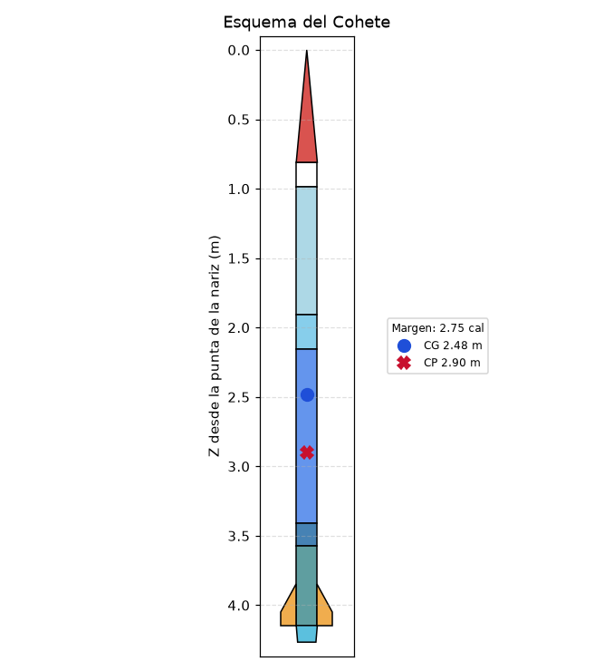
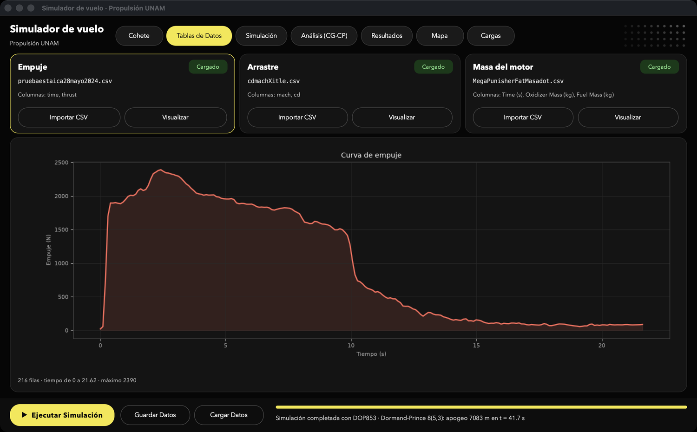
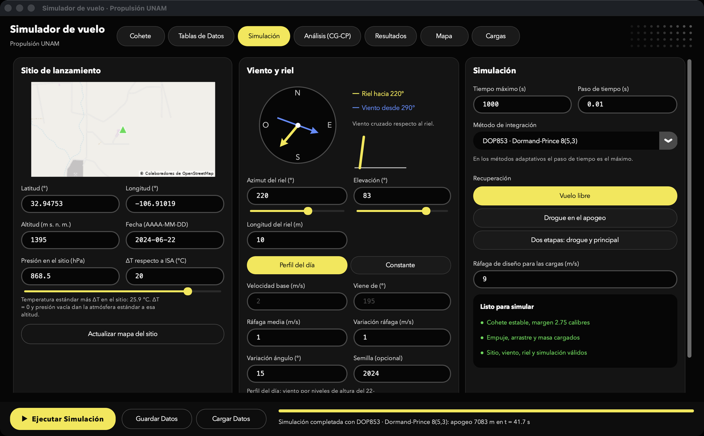
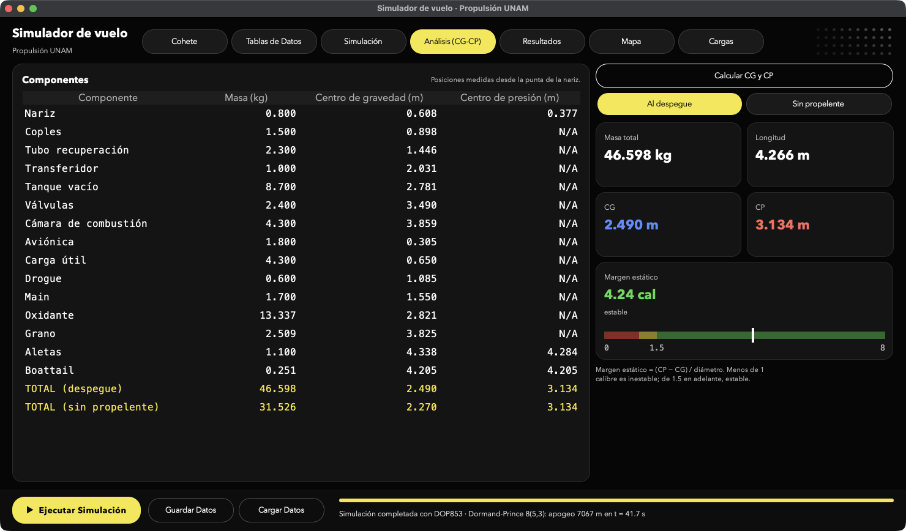
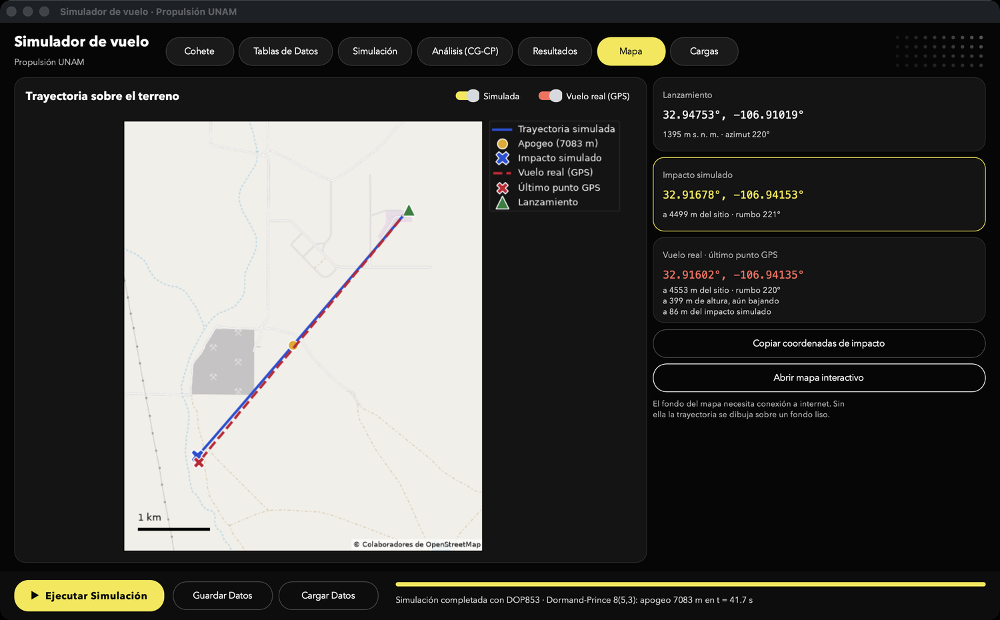
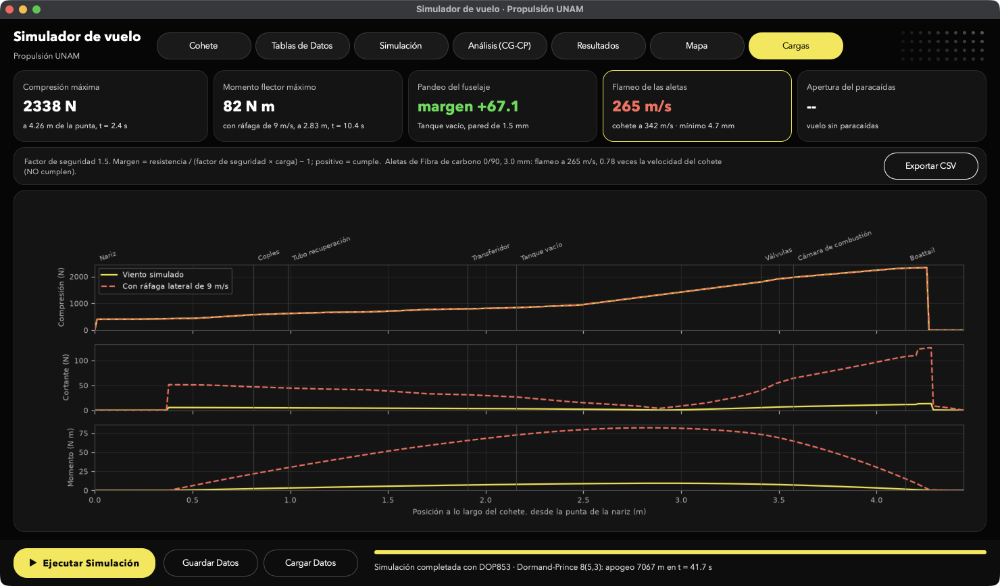
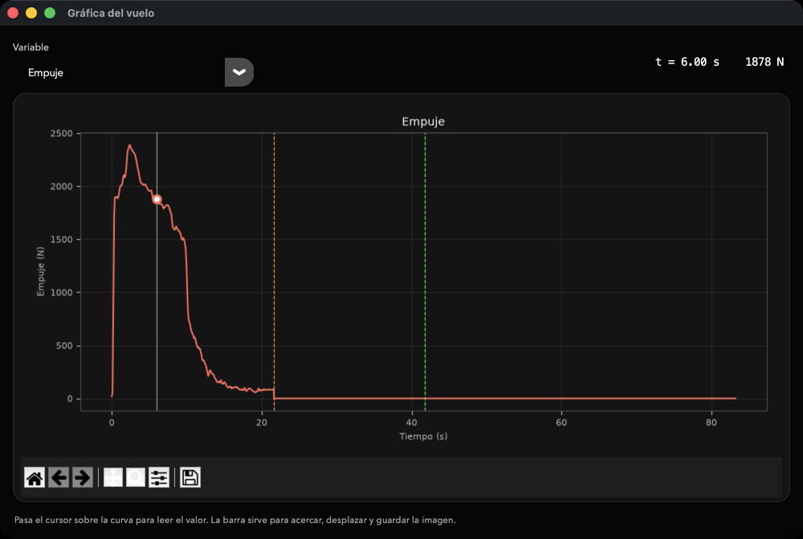

# Simulador de vuelo de cohetes (3-DOF) — Propulsión UNAM

Simulador de la trayectoria de un cohete suborbital. Resuelve tres grados de libertad en el plano de vuelo (avance, altura y ángulo de cabeceo) y, además, la deriva lateral que produce el viento cruzado. Lo escribí como parte de mi tesis de licenciatura en Matemáticas (Facultad de Ciencias, UNAM), *Simulación Numérica de la Dinámica de un Cohete Híbrido*, trabajando con el equipo Propulsión UNAM de la Facultad de Ingeniería. El cohete de referencia es el Xitle II, un cohete híbrido con óxido nitroso como oxidante que el equipo voló en 2024.

Mi tesis completa está en el repositorio: [Tesis_UNAM_NataliaMejBau_COMPLETAFINAL.pdf](./Tesis_UNAM_NataliaMejBau_COMPLETAFINAL.pdf).

## Qué hace

- Arma el cohete a partir de sus piezas (nariz, tubos, aletas, boattail, tanques, carga interna) y calcula masa, centro de gravedad, centro de presión y momento de inercia. La masa cambia durante el quemado según la tabla del motor.
- Integra el vuelo desde el riel hasta el impacto con empuje tomado de una curva medida, arrastre con Cd en función del Mach, fuerza normal, gravedad variable con la altura y viento con ráfagas.
- Usa la altitud del sitio y la temperatura, presión y viento del día del lanzamiento.
- Da las coordenadas donde cae el cohete y las muestra en un mapa real junto con el sitio de lanzamiento.
- Calcula las cargas estructurales del ascenso (fuerza axial, cortante y momento flector) y comprueba el pandeo del fuselaje y el flameo de las aletas.
- Simula la recuperación: vuelo libre, un drogue en el apogeo, o dos etapas (drogue en el apogeo y paracaídas principal a baja altura).
- Deja elegir el integrador: Euler, RK2, RK4 y Runge-Kutta-Fehlberg, que programé yo, o los de SciPy (RK23, RK45, DOP853, LSODA, BDF).
- Tiene una interfaz gráfica para cambiar el cohete y las condiciones de lanzamiento sin tocar el código, y scripts para graficar, animar y comparar contra los datos del vuelo real.

## Cómo se ve

<table>
  <tr>
    <td align="center"></td>
    <td align="center"></td>
  </tr>
  <tr>
    <td align="center">Esquema del Xitle II con su CG y CP.</td>
    <td align="center">Vuelo libre del Xitle II con DOP853.</td>
  </tr>
</table>

<p align="center">
  <br>
  Vuelo del Xitle II en Spaceport America: trayectoria simulada y trayectoria GPS real.
</p>

Las tres figuras las dibuja el programa (son las que aparecen dentro de la interfaz, guardadas a archivo); no son capturas de la ventana.

### Interfaz con el estilo de Propulsión UNAM

Hay una segunda interfaz, `PropulsionGUI`, con los colores del equipo: fondo negro, texto blanco y amarillo para la acción principal. Hace lo mismo que la anterior y responde mientras se escribe.

<table>
  <tr>
    <td align="center"></td>
    <td align="center"></td>
  </tr>
  <tr>
    <td align="center"><b>Cohete.</b> Lista de piezas, esquema que se puede tocar y campos de la pieza elegida, con su material.</td>
    <td align="center"><b>Tablas de Datos.</b> Curva de empuje de la prueba estática.</td>
  </tr>
  <tr>
    <td align="center"></td>
    <td align="center"></td>
  </tr>
  <tr>
    <td align="center"><b>Simulación.</b> Sitio, brújula del riel y del viento, y parámetros de la corrida.</td>
    <td align="center"><b>Análisis (CG-CP).</b> Tabla por componente y margen estático.</td>
  </tr>
  <tr>
    <td align="center"></td>
    <td align="center"></td>
  </tr>
  <tr>
    <td align="center"><b>Resultados.</b> Cifras del vuelo y seis gráficas con el cursor de tiempo en el apogeo.</td>
    <td align="center"><b>Mapa.</b> Trayectoria simulada y trayectoria GPS real.</td>
  </tr>
  <tr>
    <td align="center" colspan="2"></td>
  </tr>
  <tr>
    <td align="center" colspan="2"><b>Cargas.</b> Compresión, cortante y momento flector a lo largo del cohete, con el pandeo del fuselaje y el flameo de las aletas.</td>
  </tr>
</table>

Son capturas de la ventana con el Xitle II, después de simular un vuelo libre con DOP853. En la de Resultados el vuelo está detenido a los 19.8 s y el cohete de la trayectoria muestra el cabeceo de ese instante.

<p align="center">
  <br>
  Una gráfica ampliada con doble clic: el empuje, con el valor que hay bajo el cursor.
</p>

## Ejecutable, sin instalar Python

`PropulsionGUI` se puede usar como un programa normal, sin Python ni terminal. Hay un ejecutable para cada sistema, porque el de uno no sirve en otro.

| Sistema | Archivo | Cómo abrirlo |
| --- | --- | --- |
| macOS | `PropulsionGUI-macOS.zip` | Descomprimir y abrir `PropulsionGUI.app` |
| Windows | `PropulsionGUI-Windows.zip` | Descomprimir la carpeta y abrir `PropulsionGUI.exe` |
| Linux | `PropulsionGUI-Linux.tar.gz` | Descomprimir la carpeta y abrir `PropulsionGUI` |

Los tres archivos se publican en la sección [Releases](https://github.com/Meijix/RocketTrajectorySimulator-PropulsionUnam/releases) del repositorio cada vez que se sube una etiqueta de versión (por ejemplo `v1.0`). Los construye GitHub con el flujo `.github/workflows/ejecutables.yml`, que también se puede lanzar a mano desde la pestaña Actions.

El programa trae adentro los datos del Xitle II, así que abre listo para simular. En Windows y Linux el ejecutable tiene que quedarse dentro de su carpeta, junto a los archivos que lo acompañan.

Los ejecutables no están firmados, y el sistema avisa la primera vez:

- **macOS.** Clic derecho sobre la aplicación y "Abrir", y luego "Abrir" otra vez en el aviso. En versiones recientes hay que autorizarla en Ajustes del Sistema, Privacidad y seguridad.
- **Windows.** En el aviso de SmartScreen, "Más información" y "Ejecutar de todas formas".
- **Linux.** Si no abre, darle permiso de ejecución con `chmod +x PropulsionGUI`.

La primera vez tarda más en abrir, porque matplotlib prepara su lista de fuentes.

Para construir el ejecutable del sistema en el que se está trabajando:

```bash
pip install pyinstaller
pyinstaller empaquetado/PropulsionGUI.spec
dist/PropulsionGUI.app/Contents/MacOS/PropulsionGUI --autoprueba   # en macOS
```

El resultado queda en `dist/`. La opción `--autoprueba` abre la ventana, corre un vuelo y la cierra, y sirve para comprobar que el ejecutable quedó bien. En Windows y Linux el ejecutable está en `dist/PropulsionGUI/`.

## Instalación

Hace falta Python 3 con `tkinter`. Está probado con Python 3.12. El Python de Homebrew no trae `tkinter`; en ese caso hay que instalar también el paquete `python-tk` o usar otra distribución.

```bash
git clone https://github.com/Meijix/RocketTrajectorySimulator-PropulsionUnam.git
cd RocketTrajectorySimulator-PropulsionUnam
python -m venv venv
source venv/bin/activate        # en Windows: .\venv\Scripts\activate
pip install -r requirements.txt
```

Dependencias: `numpy`, `scipy`, `pandas`, `matplotlib`, `customtkinter`, `tkintermapview`, `tqdm` y `seaborn`.

## Uso

Todo se ejecuta desde la carpeta raíz del repositorio.

### Interfaz gráfica

```bash
python -m Simulador.GUI.ModernGUI
```

La ventana abre con los datos del Xitle II ya cargados, así que se puede simular de inmediato.

1. **Cohete.** Dimensiones, masas y posiciones de cada componente. La posición Z se mide desde la punta de la nariz hasta el frente de la pieza. "Actualizar Cohete" redibuja el esquema con el CG y el CP.
2. **Tablas de Datos.** Curva de empuje, Cd contra Mach y masa del motor. Se pueden importar otros CSV, con las mismas columnas que los de `Archivos/`.
3. **Simulación.** Sitio de lanzamiento (coordenadas y altitud), atmósfera del día, viento, riel (longitud, elevación y azimut), paso de tiempo, integrador y modo de recuperación (vuelo libre, drogue, o drogue y principal).
4. **Análisis (CG-CP).** Tabla por componente y margen estático al despegue y con los tanques vacíos.
5. **Resultados.** Tras "Ejecutar Simulación" aparecen el resumen del vuelo, con las coordenadas donde cae el cohete, y las gráficas. "Exportar CSV" guarda la trayectoria, con latitud y longitud de cada punto.
6. **Mapa.** Mapa real de la zona (OpenStreetMap) con el sitio de lanzamiento, la trayectoria sobre el terreno, el apogeo y el punto de impacto con sus coordenadas. "Abrir mapa interactivo" lo abre en el navegador, donde se puede acercar y mover. Si el lanzamiento es desde el sitio del vuelo real, se dibuja también la trayectoria GPS medida.

"Guardar Datos" y "Cargar Datos" escriben y leen la configuración completa en un archivo JSON.

Por defecto el sitio, la atmósfera y el viento son los del vuelo real del Xitle II (Spaceport America, 22 de junio de 2024). Para otro lanzamiento basta cambiar las coordenadas, la altitud y el azimut, y elegir el viento constante.

Dos avisos:

- El mapa necesita conexión a internet. Sin ella, la trayectoria se dibuja sobre un fondo en blanco y las coordenadas se muestran igual.
- En la pestaña "Simulación" hay además un mapa pequeño del sitio que solo funciona con Tk 8. Con Tk 9 la librería de ese mapa cierra el programa, así que en su lugar se muestran las coordenadas. La pestaña "Mapa" funciona con cualquier versión.

### Interfaz gráfica con el estilo de Propulsión UNAM

```bash
python -m Simulador.GUI.PropulsionGUI
```

Tiene las mismas siete pestañas y usa el mismo motor de simulación. También abre con el Xitle II cargado. Arriba están las pestañas y abajo, siempre a la vista, el botón amarillo "Ejecutar Simulación", "Guardar Datos", "Cargar Datos" y el estado de la corrida.

1. **Cohete.** A la izquierda está la lista de piezas, en tres grupos: externas, internas y propelentes. Al elegir una, sus campos aparecen a la derecha. También se puede elegir tocándola en el dibujo. Al cambiar un valor, el dibujo, el centro de gravedad, el centro de presión y el margen estático se recalculan solos, sin oprimir ningún botón. La masa se puede mover además con un control deslizante. "Restablecer valores del Xitle II" regresa todas las piezas a sus valores originales.
2. **Tablas de Datos.** Una tarjeta por tabla (empuje, arrastre y masa del motor) con el archivo en uso. "Importar CSV" carga otro archivo y "Visualizar" lo grafica. Si la tabla de masa dura distinto que la curva de empuje, lo avisa debajo de la gráfica.
3. **Simulación.** Los datos del sitio con un mapa de los alrededores, una brújula que muestra hacia dónde apunta el riel y de dónde viene el viento, y los parámetros de la integración. El azimut, la elevación y la temperatura se pueden escribir o mover con el control deslizante. El viento se elige entre el perfil del día del vuelo y uno constante, y la recuperación entre vuelo libre, drogue, o drogue y principal. Abajo a la derecha hay una lista que dice si todo está listo para simular o qué dato hay que corregir.
4. **Análisis (CG-CP).** La tabla por componente y, a un lado, masa, CG, CP y margen estático. Un selector cambia entre el cohete al despegue y sin propelente, y una barra muestra en qué zona cae el margen: inestable, marginal o estable.
5. **Resultados.** Las cifras del vuelo en tarjetas y seis gráficas con un cursor de tiempo común, que se mueve de tres maneras: pasando el ratón sobre cualquier gráfica, con el control deslizante o con "Reproducir", que recorre el vuelo solo a 1, 5 o 20 veces la velocidad real. Junto al control se leen el tiempo, la altura, la velocidad, el Mach y el ángulo de cabeceo de ese instante. En la gráfica de la trayectoria el cursor es un cohete pequeño que se inclina según el cabeceo. Un doble clic sobre una gráfica la abre en una ventana grande, donde un menú cambia la variable (empuje, arrastre, masa, margen estático y otras) y el valor se lee al pasar el ratón. La barra bajo las gráficas sirve para acercar, desplazar y guardar la imagen. "Exportar CSV" guarda la trayectoria.
6. **Mapa.** El mapa de la zona con el sitio, el apogeo, el impacto y, si el lanzamiento es desde el sitio del vuelo real, la trayectoria GPS. Dos interruptores muestran u ocultan la trayectoria simulada y la real. A la derecha están las coordenadas, "Copiar coordenadas de impacto" y "Abrir mapa interactivo".
7. **Cargas.** La compresión, el cortante y el momento flector a lo largo del cohete, con el viento simulado y con la ráfaga de diseño. Arriba, en tarjetas, la compresión y el momento máximos, el margen de pandeo del fuselaje, la velocidad de flameo de las aletas y la carga de apertura del paracaídas; el pandeo y el flameo salen en verde si cumplen y en rojo si no. Usa el material de cada tramo y el espesor de las aletas elegidos en "Cohete". "Exportar CSV" guarda las cargas.

Si un campo queda con un valor que no sirve (por ejemplo, vacío mientras se escribe), el aviso aparece en la barra de abajo y los cálculos se retoman en cuanto el valor es válido.

Las configuraciones guardadas sirven en las dos interfaces, porque el archivo JSON es el mismo.

Diferencias con `ModernGUI`:

- El mapa del sitio en la pestaña "Simulación" funciona también con Tk 9.
- No hay botón "Actualizar Cohete", porque el esquema se actualiza solo.
- La letra es Lexend si está instalada en el sistema; si no, usa otra parecida.

### Sin interfaz

```bash
python -m Simulador.src.VueloLibre        # sin paracaídas
python -m Simulador.src.VueloParacaidas   # con drogue y paracaídas principal
```

El cohete se define en `Simulador/src/XitleFile.py` y las condiciones (riel, viento, paso, integrador) en `Simulador/src/condiciones_init.py`. Los resultados se guardan en `Simulador/Resultados/OutputFiles/` como CSV y JSON.

Con esos archivos trabajan los scripts de `Simulador/Visualizacion/` (gráficas y animaciones) y `Simulador/Resultados/real_vs_simulada.py`, que compara la altura simulada con la medida.

### Pruebas

```bash
pip install -r requirements-dev.txt
python -m pytest tests
```

Tardan medio minuto. Comparan la atmósfera con la ISA, los integradores con soluciones analíticas y varios vuelos completos entre sí.

## El modelo

El cohete es un cuerpo rígido con tres grados de libertad en el plano vertical que contiene al riel: avance (x), altura (z) y cabeceo (θ). El estado lleva también la posición lateral (y), que solo cambia por el arrastre cuando hay viento cruzado: el cohete se desplaza de lado, pero no gira fuera del plano. No hay alabeo ni guiñada.

Las fuerzas son:

- **Empuje.** Interpolado de la curva del motor, a lo largo del eje del cohete.
- **Arrastre.** Con el Cd interpolado de una tabla contra el número de Mach. Cada paracaídas abierto suma su propio arrastre.
- **Fuerza normal.** Proporcional al seno del ángulo de ataque. Aplicada en el centro de presión, es la que endereza al cohete.
- **Gravedad.** Disminuye con la altura.
- **Amortiguamiento del cabeceo.** Dos momentos que se oponen al giro: el aerodinámico, proporcional a la velocidad del aire y a la suma de CN·d² de nariz, aletas y boattail (d es la distancia de cada uno al centro de gravedad), y el del chorro del motor, proporcional al flujo de masa y al cuadrado de la distancia de la tobera al centro de gravedad.
- **Viento.** Horizontal, con ráfagas. Puede ser constante o un perfil que cambia con la altura. Cada segundo se sortean una ráfaga, que se suma a la rapidez base, y una pequeña desviación de la dirección, y se interpola entre sorteos. Las ráfagas tienen además una componente vertical pequeña, de media cero. Con una semilla, el viento se repite igual en cada corrida.

La recuperación puede ser en dos etapas. El drogue se abre en el apogeo y el paracaídas principal al bajar por una altura dada sobre el sitio (450 m por defecto); el drogue sigue abierto. Si el apogeo queda por debajo de esa altura, el principal se abre en el apogeo. Para el Xitle II, con el drogue baja a unos 34 m/s y con el principal aterriza a 12 m/s, a los 250 s del despegue.

Los paracaídas no se abren de golpe. El área de arrastre de cada uno crece desde cero durante un tiempo de llenado. Los valores por defecto son los de un paracaídas circular plano de tela maciza: el tiempo de llenado es `t = 8·D/v^0.9` (relación empírica de Knacke, con el diámetro `D` en pies y la velocidad `v` al abrirse en pies por segundo; el programa hace la conversión) y el área crece como `(tiempo/t)^6` (Ludtke), es decir, casi nada al principio y de golpe al final. La constante de llenado se puede cambiar en la interfaz; con 0 la apertura es instantánea. El principal del Xitle II tarda 0.58 s en llenarse y su carga de apertura es de unos 1680 N (5.4 g); con apertura instantánea saldrían 2240 N (7.2 g). El punto y el tiempo de caída casi no cambian. La interfaz muestra esa carga en los resultados.

Mientras el cohete está en el riel no gira y solo puede deslizarse a lo largo de su eje: el riel absorbe las fuerzas laterales y lo sostiene hasta que el empuje vence al peso.

La masa de propelente baja en proporción al impulso entregado por el motor, entre las masas inicial y final de la tabla del motor. Se hace así porque la tabla de masa del Xitle II viene de una simulación del motor que dura 10 s, y la curva de empuje es de una prueba estática que dura 21.6 s; si las dos tablas duraran lo mismo, se usaría la de masa tal cual. El oxidante que queda ocupa la parte trasera del tanque: la columna de líquido se acorta en proporción a su masa y su fondo no se mueve, así que su centro baja hacia la cola y su momento de inercia propio disminuye más rápido que su masa. El grano de combustible se quema desde su canal central: el diámetro exterior y la longitud no cambian y el canal se ensancha según la masa que queda. El centro de gravedad y el momento de inercia del cohete se recalculan con todo eso en cada instante.

### Sitio, atmósfera y viento del día

El origen del simulador es el sitio de lanzamiento. El eje x apunta hacia donde se inclina el riel (su azimut, medido desde el norte), y con eso cada punto de la trayectoria se convierte a latitud y longitud.

La atmósfera es la estándar (ISA) por capas, ajustada al sitio y al día con tres datos: la altitud del sitio, la diferencia de temperatura respecto a la ISA y la presión medida en el sitio. La presión a cada altura sale de integrar el equilibrio hidrostático desde el sitio, y la densidad de la ecuación de gas ideal. Sin esos datos queda la ISA al nivel del mar.

Para el vuelo real del Xitle II los valores están en `Archivos/DatosVuelo/condiciones_2024-06-22.json`, con sus fuentes:

| Dato | Valor | De dónde sale |
| --- | --- | --- |
| Sitio | 32.94753° N, 106.91019° O, 1395 m s. n. m. (Spaceport America) | primer punto GPS del rastreador |
| Fecha y hora | 22 de junio de 2024, hacia las 12:20 hora local | registro GPS y nombre del archivo |
| Azimut del lanzamiento | 220° | rumbo de la trayectoria GPS |
| Elevación del riel | 83° | la que reproduce la trayectoria GPS (no hay registro del ángulo) |
| Temperatura en superficie | 28 a 31 °C (ISA + 20 °C en toda la columna) | reanálisis ERA5 y archivo de pronósticos |
| Presión en el sitio | 868.5 hPa | ídem |
| Viento en superficie | 1 a 2 m/s del oeste-noroeste, ráfagas de 2 a 5 m/s | ídem |
| Viento en altura | 3 m/s a 6 km y 7 m/s a 7.7 km, del sur-suroeste | ídem |

Los datos meteorológicos son de modelo (Open-Meteo), no mediciones en la plataforma. Con ISA + 20 °C el modelo reproduce las alturas de 700, 600, 500 y 400 hPa de ese día con menos de 0.5 % de error en la presión. El viento se usa como perfil con la altura, con la dirección en convención meteorológica (de dónde viene, en grados desde el norte).

Los centros de presión y los coeficientes de fuerza normal de la nariz, las aletas y el boattail salen de las fórmulas de Barrowman. El desarrollo completo está en mi tesis.

### Integradores

| Nombre en el código | Método | Paso |
| --- | --- | --- |
| `Euler` | Euler explícito, orden 1 | fijo |
| `RungeKutta2` | Heun (trapecio explícito), orden 2 | fijo |
| `RungeKutta4` | Runge-Kutta clásico, orden 4 | fijo |
| `RKF45` | Runge-Kutta-Fehlberg 4(5) | adaptativo |
| `RK23` (SciPy) | Bogacki-Shampine 3(2) | adaptativo |
| `RK45` (SciPy) | Dormand-Prince 5(4) | adaptativo |
| `DOP853` (SciPy) | Dormand-Prince de orden 8, con estimadores de orden 5 y 3 | adaptativo |
| `LSODA` (SciPy) | Adams y BDF con cambio automático | adaptativo |
| `BDF` (SciPy) | Diferenciación hacia atrás, orden 1 a 5 | adaptativo |

Los cuatro primeros los programé para la tesis y están en `Paquetes/PaqueteEDOs/integradores.py`. Los demás son los de `scipy.integrate.solve_ivp`.

Ojo con los nombres: el `RK45` de SciPy no es Runge-Kutta-Fehlberg sino Dormand-Prince 5(4). Los dos son pares de orden 4 y 5, pero con coeficientes distintos. El Fehlberg es `RKF45`.

En los métodos de paso fijo el paso configurado es el que se usa siempre. En los adaptativos es el paso máximo. La integración se detiene al tocar el suelo, o al llegar al tiempo máximo (1000 s por defecto) si no hay impacto antes.

La lista de métodos, con sus nombres, está en un solo lugar (`Paquetes/PaqueteEDOs/metodos.py`) y de ahí la toman el simulador, la interfaz y todas las comparaciones.

### Comparación de los integradores en el vuelo completo

```bash
python -m Simulador.Visualizacion.compare_integ
```

Simula el mismo vuelo con los nueve métodos y los compara con una solución de referencia (DOP853 con un paso cinco veces menor). Guarda la tabla y las figuras en `Simulador/Resultados/OutputFiles/ComparacionIntegradores/`. Para el vuelo libre del Xitle II con paso de 0.01 s:

| Método | Apogeo | Diferencia de apogeo con la referencia | Evaluaciones de f | Tiempo de cómputo |
| --- | --- | --- | --- | --- |
| Euler | 7083 m | 0.77 m | 8 320 | 2.0 s |
| RK2 | 7082 m | −0.09 m | 16 638 | 3.0 s |
| RK4 | 7083 m | 0.05 m | 33 276 | 4.9 s |
| RKF45 | 7083 m | 0.01 m | 50 352 | 7.1 s |
| RK23 | 7082 m | −0.16 m | 24 992 | 4.1 s |
| RK45 | 7082 m | −0.17 m | 49 928 | 6.9 s |
| DOP853 | 7083 m | 0.11 m | 99 920 | 12.7 s |
| BDF | 7082 m | −0.22 m | 16 910 | 3.7 s |
| LSODA | 7082 m | −0.07 m | 12 263 | 2.5 s |

Los tiempos dependen de la máquina; las evaluaciones de f no.

## Cargas estructurales

`Paquetes/PaqueteFisica/cargas.py` calcula, con la trayectoria ya simulada, lo que soporta cada sección del cohete durante el ascenso: la fuerza axial (compresión), el cortante y el momento flector.

```bash
python -m Simulador.Resultados.cargas_estructurales
```

El script guarda la tabla y la figura en `Simulador/Resultados/OutputFiles/CargasEstructurales/`. En las dos interfaces están en la pestaña "Cargas", con un botón para exportarlas.

El cohete se trata como una viga libre. En cada instante se reparten sobre ella las fuerzas del simulador, se obtienen las aceleraciones que producen y, con las fuerzas de inercia, las cargas internas en cada corte. Dónde actúa cada fuerza es una hipótesis:

- El empuje entra por el extremo trasero del fuselaje.
- El arrastre actúa en la punta de la nariz. Es el reparto más desfavorable para la compresión de los tramos delanteros.
- La fuerza normal se reparte entre nariz, aletas y boattail según su coeficiente, cada una en su centro de presión.
- La masa de cada componente se reparte a lo largo de su longitud.
- En el riel solo hay carga axial: las fuerzas laterales las absorbe el riel.

Con el viento del vuelo simulado el ángulo de ataque es muy pequeño y casi no hay flexión. Por eso se calcula además un caso con una ráfaga lateral de diseño (9 m/s por defecto, se puede cambiar): la ráfaga llega de golpe en cada instante del ascenso, sin que el cohete alcance a girar. Para el Xitle II:

| Carga máxima | Viento simulado | Con ráfaga de 9 m/s |
| --- | --- | --- |
| Compresión | 2387 N, junto a la cola, a los 2.4 s (empuje máximo) | igual |
| Cortante | 8 N | 101 N |
| Momento flector | 5 N·m | 57 N·m, a 2.5 m de la punta, a los 10.5 s (Mach 1) |

El análisis es cuasiestático: en cada instante de la trayectoria se equilibran las fuerzas aplicadas con las de inercia del cohete como cuerpo rígido. No incluye vibraciones ni la deformación elástica del fuselaje. La carga de apertura de los paracaídas se obtiene aparte, de la simulación del descenso.

### Pandeo del fuselaje y flameo de las aletas

Con esas cargas, `Paquetes/PaqueteFisica/resistencia.py` comprueba el fuselaje y las aletas. El material de cada tramo del fuselaje y el material y el espesor de las aletas se eligen en la pestaña "Cohete" de las dos interfaces. Por defecto son los del Xitle II: fuselaje de fibra de carbono, coples de aluminio 6061-T6 y aletas de tejido de carbono 0/90 de 3 mm. Las propiedades de cada material y el factor de seguridad (1.5) están en `Archivos/estructura_xitle.json`, con sus fuentes; ahí se pueden corregir o añadir materiales. El resultado se da como margen: `resistencia / (factor × carga) − 1`; si es positivo, cumple.

- **Fuselaje.** Cada tramo cilíndrico se comprueba a compresión y flexión combinadas contra el pandeo de pared delgada (fórmula clásica con el factor de reducción por imperfecciones de NASA SP-8007) y contra la resistencia a compresión del material. Para el Xitle II las cargas de vuelo quedan muy lejos del pandeo: el tramo más cargado es el tanque, con margen de +80, y un tubo de 1.5 mm de pared pandearía con unos 390 kN de compresión, frente a los 2.4 kN del vuelo.
- **Aletas.** Se compara la velocidad del cohete con la velocidad de flameo de NACA TN 4197 a lo largo del ascenso. Las aletas del Xitle II (tejido 0/90, módulo de cortante de 5 GPa, 3 mm) flamearían a 265 m/s y el cohete llega a 342 m/s: no cumplen, y harían falta 4.7 mm. Con capas a ±45° (unos 18 GPa) el flameo sube a 503 m/s y bastan 3 mm.

Las propiedades de la fibra de carbono son valores de catálogo: hay que sustituirlos por los del laminado real. El espesor de pared del fuselaje sale de los diámetros de `XitleFile.py`, que dan 1.5 mm. La fórmula de flameo es una estimación para aletas delgadas en régimen subsónico; cerca de Mach 1 es solo orientativa.

## Comparación con el vuelo real

El Xitle II voló el 22 de junio de 2024 en Spaceport America. Hay tres registros: la trayectoria GPS del rastreador Featherweight, la altura de la telemetría ASYB y la curva de altura contra tiempo. El cohete bajó sin paracaídas: el último punto GPS lo muestra a 399 m de altura cayendo a 273 m/s.

La simulación usa el sitio, la atmósfera y el viento de ese día (vuelo libre, DOP853):

| | Vuelo real | Simulación |
| --- | --- | --- |
| Apogeo sobre el sitio | 6573 m (GPS), 6569 m (curva de altura) | 7083 m |
| Tiempo al apogeo | unos 40 s | 41.7 s |
| Distancia horizontal en el apogeo | 2532 m | 2471 m |
| Rumbo de la trayectoria | 220° | 221° |
| Punto de caída | último GPS en 32.91602°, −106.94135°, a 4553 m del sitio | 32.91678°, −106.94153°, a 4499 m |
| Velocidad de caída | 273 m/s a 399 m de altura | 285 m/s en el impacto |

La trayectoria sobre el terreno coincide bien: el impacto simulado queda a 86 m del último punto GPS, que todavía estaba en el aire. La elevación del riel se ajustó para eso, así que no es una predicción independiente. El apogeo sale 7.8 % por encima del medido.

Esa diferencia no viene de la atmósfera ni del integrador. Para igualar el apogeo medido haría falta bajar el empuje un 5 % o subir el arrastre un 25 %, así que lo que hay que revisar es la curva de empuje (es de una prueba estática, no del vuelo), la masa del cohete o la tabla de Cd. Como referencia, OpenRocket da 5955 m.

Los datos del vuelo están en `Archivos/` y la discusión completa en el capítulo 5 de la tesis. Las cifras de la tesis las obtuve con una versión anterior del código, que suponía atmósfera al nivel del mar, y no coinciden con las de esta tabla.

## Casos simples

`Simulador/CasosSimples/Simples/` tiene tres problemas con solución analítica para comparar los nueve métodos entre sí, variando el paso de tiempo:

- `caso1.py`: movimiento vertical con gravedad y masa constante.
- `caso2.py`: gravedad y arrastre lineal.
- `caso3.py`: gravedad y arrastre cuadrático.

Los métodos de paso fijo se corren con seis pasos distintos. Los adaptativos, con esos mismos valores como paso máximo y además con paso libre.

Cada script guarda, en la carpeta con su nombre:

- `tabla_metodos.csv`: una fila por método y paso, con el número de pasos, las evaluaciones de f, el tiempo de cómputo y los errores de posición y velocidad.
- `figuras/`: todas las gráficas, numeradas en el orden en que se muestran.

Las imágenes sueltas que hay en esas carpetas son anteriores: solo incluyen seis métodos y llaman RK45 a lo que era Dormand-Prince.

## Organización del repositorio

```text
Paquetes/
  PaqueteFisica/     cohete, componentes, vuelo, atmósfera, viento, riel
  PaqueteEDOs/       integradores propios y catálogo de todos los métodos
  utils/             lectura y guardado de datos, dibujo del cohete
Simulador/
  GUI/               ModernGUI.py y PropulsionGUI.py (interfaces), backend.py (conexión con el simulador)
    propulsion/      módulos de PropulsionGUI: tema, controles, pestañas y ventana
  src/               definición del Xitle II, condiciones iniciales y scripts de vuelo
  Visualizacion/     gráficas y animaciones
  Resultados/        resultados guardados y comparación con el vuelo real
  VarParams/         barridos de parámetros
  CasosSimples/      casos de prueba de los integradores
Archivos/            curvas de empuje, tabla de Cd y datos del vuelo real
Extras/              scripts sueltos de análisis y prototipos
tests/               pruebas automáticas
empaquetado/         receta de PyInstaller para el ejecutable
docs/                documentación del código, sección por sección
```

La documentación de cada sección del código está en [docs/](./docs/README.md) (en inglés). El [reporte de diseño del Xitle II](./docs/reporte-xitle2.md) reúne los números del cohete, su interpretación y la comparación con el vuelo real.

`Simulador/GUI/GUI.py` es la interfaz anterior. Se conserva como referencia; las que se mantienen son `ModernGUI.py` y `PropulsionGUI.py`, que comparten `backend.py`.

## Limitaciones conocidas

- El modelo es plano: no hay alabeo ni guiñada. El viento cruzado desplaza al cohete de lado por arrastre, pero no lo hace girar hacia el viento.
- El inflado de los paracaídas es un modelo sencillo (área que crece en un tiempo de llenado), con las constantes de un paracaídas circular plano. No incluye la masa de aire que arrastra el paracaídas ni la elasticidad de las líneas, así que la carga de apertura es una estimación.
- El apogeo simulado del Xitle II queda 8 % por encima del medido (ver la comparación con el vuelo real).
- La fuerza normal se aplica perpendicular a la velocidad relativa, no al eje del cohete. Para ángulos de ataque pequeños es equivalente.
- El centro de presión y los coeficientes de fuerza normal son los de Barrowman, válidos en régimen subsónico y ángulos pequeños; se usan sin corrección hasta Mach 1.
- El empuje es el de la prueba estática, sin corregir por la menor presión ambiente en altura.
- El oxidante se supone siempre asentado en el fondo del tanque, también después del quemado, cuando el cohete desacelera. Para entonces queda menos de 1 kg.
- La atmósfera del día se describe con un solo ajuste de temperatura para toda la columna; no usa un sondeo completo.
- Algunos scripts de `Extras/` y `Simulador/VarParams/` los dejé a medias y no corren tal cual.

## Pendientes

- Pasar a seis grados de libertad.
- Análisis de dispersión por Monte Carlo.
- Comprobación del resto de la estructura: uniones atornilladas, herrajes de recuperación y tanque a presión.

## Créditos

- Autora: Natalia Edith Mejia Bautista.
- Mis asesores de tesis: Dra. Ursula X. Iturrarán Viveros y Dr. Juan Claudio Toledo Roy.
- Propulsión UNAM aportó el cohete, las pruebas del motor y los datos del vuelo.

Para reportar errores o proponer cambios, abre un [issue](https://github.com/Meijix/RocketTrajectorySimulator-PropulsionUnam/issues) o un pull request.

## Licencia

MIT. Ver [LICENSE](./LICENSE).
