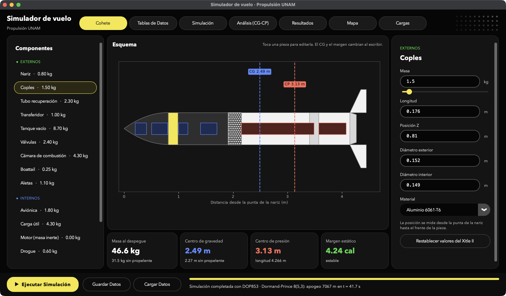
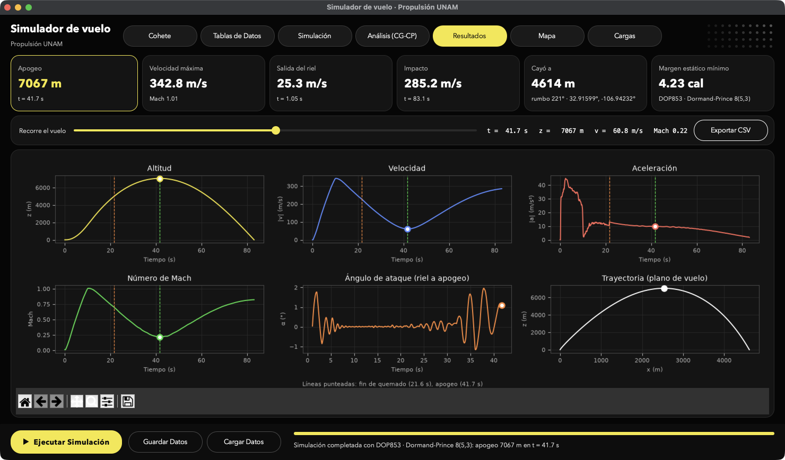
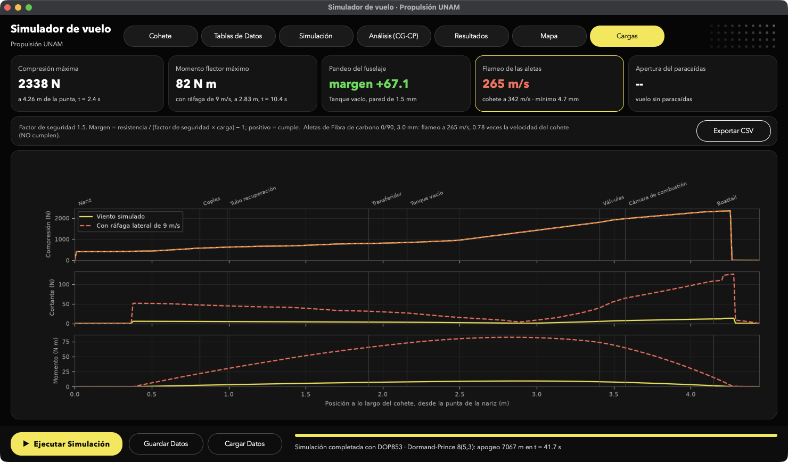

# Graphical interface

[Simulador/GUI/](../Simulador/GUI/) has two interfaces built with customtkinter and the code they share.

| File | Role |
| --- | --- |
| [PropulsionGUI.py](../Simulador/GUI/PropulsionGUI.py) | launcher of the interface with the Propulsión UNAM look |
| [propulsion/](../Simulador/GUI/propulsion/) | the modules of that interface |
| [ModernGUI.py](../Simulador/GUI/ModernGUI.py) | the earlier interface, in one file |
| [backend.py](../Simulador/GUI/backend.py) | turns form values into simulator objects and results |
| [mapa.py](../Simulador/GUI/mapa.py) | map background and interactive map |
| [GUI.py](../Simulador/GUI/GUI.py) | the first interface, kept for reference |

```bash
python -m Simulador.GUI.PropulsionGUI
python -m Simulador.GUI.ModernGUI
```

Both windows have the same seven tabs and do the same things. They only collect values and draw results. All the computation is in the backend, which does not import tkinter, so it can be tested and used from a script without opening a window. A configuration saved from one interface loads in the other.

## Backend

### Parameters

The backend works with one flat dictionary of parameters. `PARAMS_XITLE` holds the default for every field, which is the Xitle II as defined in [XitleFile.py](../Simulador/src/XitleFile.py) and the conditions of its real flight. `RUTAS_XITLE` holds the paths of the three data tables under the keys `thrust`, `drag` and `mass`.

Field names carry a prefix for the component and a suffix for the quantity, such as `nose_len`, `coples_mass` or `cc_diam_ext`. Lengths are in metres, masses in kilograms and angles in degrees. A `_pos_z` field is the distance from the nose tip to the front of the component.

A few fields are text. `integrator` takes a flight key from the list `INTEGRADORES`. `recovery` takes one of the three entries of `RECUPERACION`, which are free flight, drogue at apogee, and drogue at apogee plus main parachute. `wind_mode` takes one of the two entries of `VIENTOS`, the profile of the flight day or a constant wind. `wind_seed` and `atm_pressure_hpa` may be left empty, which means a different wind on each run and the standard pressure for the site altitude.

Each fuselage tube has a `_material` field, such as `coples_material` or `tanque_vacio_material`, and the fins have `fin_material` and `fin_thickness`. A material field takes one of the names in `MATERIALES`, which are read from [estructura_xitle.json](../Archivos/estructura_xitle.json): carbon fiber 0/90, quasi-isotropic carbon fiber, fiberglass 0/90 and aluminum 6061-T6. The defaults are those of the Xitle II, with aluminum couplers, a carbon fiber 0/90 fuselage and fins of 0/90 carbon fabric 3 mm thick. `load_gust` is the lateral design gust, in m/s, used for the structural loads. These fields do not change the flight. They only feed the structural checks.

### Functions

| Function | Result |
| --- | --- |
| `validar_parametros(params)` | raises `ValueError` with a readable message if a value makes no physical sense |
| `construir_cohete(params, rutas)` | a `Cohete` |
| `crear_atmosfera(params)` | an `atmosfera` |
| `crear_viento(params)` | a `Viento`, from the day profile or from the constant wind fields |
| `analizar_estabilidad(params, rutas)` | per-component table plus mass, CG, CP and static margin at liftoff and with empty tanks |
| `ejecutar_simulacion(params, rutas, estado_cb, con_mapa)` | a DataFrame with the trajectory and a summary dictionary |
| `vuelo_real()` | the GPS track of the real flight read from `FTW.csv` |
| `datos_mapa_interactivo(df, resumen)` | the data the interactive map needs |
| `estructura_desde_parametros(params)` | the material catalog from the JSON file with the material of each tube and the material and thickness of the fins taken from the form |

`construir_cohete` skips internal components whose mass is zero. That is how the inert motor mass field works, since it is zero for the Xitle II.

### Running a flight without the window

```python
from Simulador.GUI import backend

params = dict(backend.PARAMS_XITLE, integrator="LSODA", wind_seed=1)
df, resumen = backend.ejecutar_simulacion(params, backend.RUTAS_XITLE)
print(resumen["apogeo"], resumen["lat_impacto"], resumen["lon_impacto"])
```

The DataFrame has one row per saved time. Its columns are `t`, position, velocity, `theta` and `alpha` in degrees, `omega`, `velocidad`, `aceleracion`, `acel_angular`, `masa`, `CG`, `CP`, `margen` in calibers, `mach`, `cd`, `gamma`, the three force magnitudes `empuje`, `arrastre` and `normal`, the wind, and `latitud` and `longitud` of each point.

The summary has the event times, apogee, top speed and Mach, largest acceleration, rail exit speed, impact speed, distance and bearing of the impact, and the coordinates of launch, apogee and impact. If the launch site is within 1 km of the real one, `resumen["vuelo_real"]` holds the GPS track so the map can draw both. With `con_mapa=True` the summary also carries the downloaded map image.

Two entries of the summary hold the structural results. `resumen["cargas"]` is the load envelope of the ascent from [cargas.py](../Paquetes/PaqueteFisica/cargas.py): the largest compression, shear and bending moment at each station along the rocket, with the simulated wind and with the design gust. `resumen["resistencia"]` is the check from [resistencia.py](../Paquetes/PaqueteFisica/resistencia.py): buckling and strength margins of each fuselage tube, and the fin flutter speed compared with the speed of the rocket. It is `None` if the check could not be made.

## Map

`descargar_mosaico` downloads the OpenStreetMap tiles that cover a set of points, joins them into one image and returns it with the pixel extent that matplotlib needs. It picks the highest zoom at which the area fits in a grid of four by four tiles. Without a connection it returns `None` and the interface draws the track on a blank background.

`a_pixeles` converts latitude and longitude to Web Mercator pixels at a given zoom. The interface uses it to draw the track over the image.

`escribir_html` writes a page with a Leaflet map that shows the simulated track, the launch, apogee and impact points, and the real track when there is one. By default the file goes to the system temporary folder, and the interface opens it in the browser.

## PropulsionGUI

This interface uses the colors of the team. The background is black, the text is white, and yellow marks the main action and the current selection. Green, blue and red identify external parts, internal parts and propellants.



### Modules

[PropulsionGUI.py](../Simulador/GUI/PropulsionGUI.py) only opens the window. The code is in [propulsion/](../Simulador/GUI/propulsion/).

| Module | Contents |
| --- | --- |
| [tema.py](../Simulador/GUI/propulsion/tema.py) | the `Tema` color class, font selection and text conversions |
| [widgets.py](../Simulador/GUI/propulsion/widgets.py) | builders for buttons, fields, sliders, cards and matplotlib figures |
| [componentes.py](../Simulador/GUI/propulsion/componentes.py) | the fields of each rocket part |
| [esquema.py](../Simulador/GUI/propulsion/esquema.py) | the rocket drawing |
| `pestana_*.py` | one tab per file |
| [app.py](../Simulador/GUI/propulsion/app.py) | the main window, the shared parameters, the simulation run and the configuration files |

### Shared parameters

`App.vars` holds one `tk.StringVar` per parameter, with the names of `backend.PARAMS_XITLE`. Every field, slider and menu is bound to one of those variables. The tabs keep no copy of the rocket. They read the variables, and `App.parametros()` turns them into the dictionary the backend expects.

`App.rutas` holds the paths of the three data tables under the keys `thrust`, `drag` and `mass`.

### Live update

Each variable calls `App.al_cambiar` when it changes. That method waits 300 ms after the last change and then calls `App.refrescar`, so typing a number triggers one recalculation and not one per key. `refrescar` runs `backend.analizar_estabilidad` and passes the result to the Cohete, Simulación and Análisis tabs through their `refrescar` method.

If a field holds something that is not a number, the stability result is `None`. The tabs keep their last drawing and the status bar shows the message from the backend.

### Form definition

`COMPONENTES` in [componentes.py](../Simulador/GUI/propulsion/componentes.py) lists the rocket parts. Each `Componente` has a key, a name, a group and its `Campo` entries, and each `Campo` names a backend parameter, a label and a unit. A `Campo` with options is drawn as a menu, which is how the material of a tube or of the fins is chosen. The Cohete tab builds the part list and the field panel from that table, so adding a field means adding one `Campo`.

The name of each part matches the name `backend.analizar_estabilidad` returns, which is how the list shows the mass the simulator uses. The first field of every part is its mass.

A test checks that every backend parameter has a field. If a parameter is added to `PARAMS_XITLE` and not to the form, the test fails and names it.

### Tabs

| Tab | Class | What it adds to the earlier interface |
| --- | --- | --- |
| Cohete | `PestanaCohete` | a part list, a drawing where a click selects a part, and cards with mass, CG, CP and margin that follow the fields |
| Tablas de Datos | `PestanaTablas` | one card per table and a warning when the mass table and the thrust curve have different durations |
| Simulación | `PestanaSimulacion` | a map of the site, a compass with the rail and the wind, sliders, and a checklist that says whether the run can start |
| Análisis (CG-CP) | `PestanaAnalisis` | a switch between liftoff and empty tanks, and a bar with the unstable, marginal and stable ranges |
| Resultados | `PestanaResultados` | cards with the flight figures and a time slider that moves a marker on the six plots |
| Mapa | `PestanaMapa` | switches that show or hide the simulated track and the GPS track |
| Cargas | `PestanaCargas` | cards with the largest compression and bending moment, the buckling margin, the fin flutter speed and the parachute opening load, in green or red depending on whether the check passes |



The Cargas tab plots the compression, the shear and the bending moment along the rocket, with one curve for the simulated wind and one for the design gust. The vertical lines are the limits of the fuselage sections. The cards above the plots summarize the structural check made with the materials chosen in the Cohete tab, and a button exports the envelope as CSV.



The rocket drawing is a matplotlib figure. `dibujar_cohete` gives every patch the key of its part, and the tab finds the patch under a click to select that part. Internal parts and propellants are drawn as a band along the axis, above the tubes, so both can be clicked.

The site map in the Simulación tab uses `mapa.descargar_mosaico` in a background thread and draws the tiles with matplotlib. It does not depend on `tkintermapview`, so it works with Tk 9.

The Simulación tab is a scrollable frame because it has the most fields. The other tabs shrink their figures to fit the window.

### Running the simulation

`App.simular` checks that the three tables exist, validates the parameters and submits `backend.ejecutar_simulacion` to a separate process. The window checks every 200 ms whether the process has finished and stays responsive in the meantime. When it finishes, the Resultados and Mapa tabs receive the DataFrame and the summary, and the Cargas tab receives the summary.

### Fonts

The interface looks for Lexend and falls back to Avenir Next, Helvetica Neue or Segoe UI. Numbers use JetBrains Mono, Menlo, Consolas or DejaVu Sans Mono. It picks the first family installed on the system.

## ModernGUI

`App` is the main window. It has seven tabs and a row of buttons.

| Tab | Class | Contents |
| --- | --- | --- |
| Cohete | `RocketTab` | one frame of fields per component, with the material of each tube and of the fins |
| Tablas de Datos | `DataTablesTab` | load and plot the thrust, Cd and motor mass tables |
| Simulación | `SimulationEnvironmentTab` | site, atmosphere, wind, rail, step, integrator, recovery |
| Análisis (CG-CP) | `StabilityTab` | per-component table and static margin |
| Resultados | `ResultsTab` | flight summary, six plots and CSV export |
| Mapa | `MapTab` | track over the map, impact coordinates, link to the interactive map |
| Cargas | `LoadsTab` | load envelope along the rocket, summary of the buckling and flutter checks, CSV export |

The buttons run the simulation, redraw the rocket sketch, and save or load the whole configuration as JSON. The saved file is the parameter dictionary plus the three table paths.

When the run button is pressed, the window validates the parameters and submits `ejecutar_simulacion` to a separate process. It checks every 200 ms whether the process has finished and keeps responding in the meantime. I run it in a process because calling the simulator from a thread of the interface is not safe with Tk.

The small map in the simulation tab uses `tkintermapview`, which crashes with Tk 9. The module checks the Tk version on import and shows the coordinates as text in that case. The map tab draws with matplotlib and works with any version.

## First interface

`GUI.py` was the first interface. It is not maintained and may not match the current physics package.
